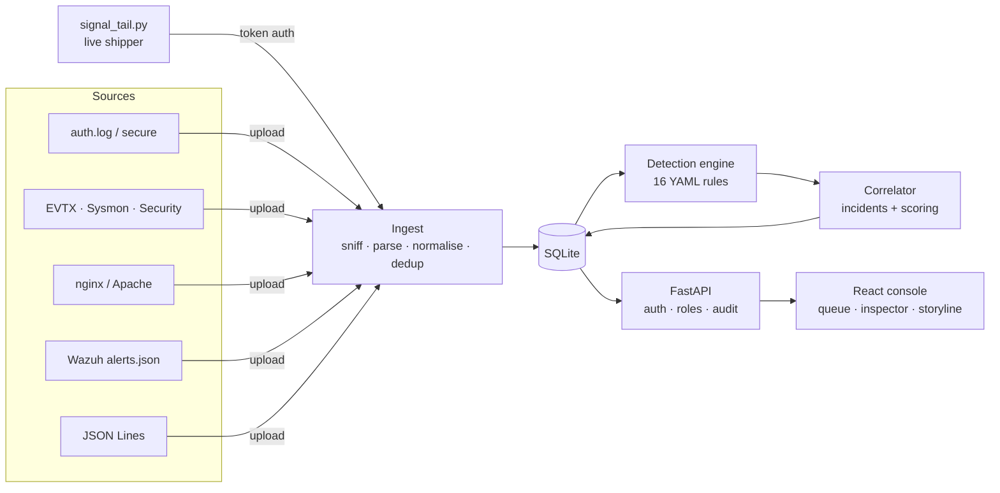

# SIGNAL

**A self-hosted mini SIEM. It ingests security logs, runs detections mapped to MITRE ATT&CK, groups related alerts into scored incidents, and gives an analyst a keyboard-first console to triage them.**

Built as a SOC analyst portfolio project to cover the Tier 1 loop end to end:
**alert → triage → investigate → true/false positive → document.**


> **Status:** Phases 1–4 of 7 are done (ingest, detection, correlation, triage).
> Phase 5 (entity pages, entity graph, hunt search) is in progress.

<!-- Add a screenshot or GIF of the incident storyline here: docs/hero.png -->

---

## What it does

- **Ingests the logs a SOC actually sees.** Linux auth, Windows Security and Sysmon (including raw `.evtx`), nginx/Apache access logs, Wazuh alerts, and any JSON Lines source with a field mapping. The format is detected from the file content, so you just drag and drop.
- **Normalises everything into one event schema,** so one rule can cover several log sources.
- **Runs 16 YAML detection rules** mapped to MITRE ATT&CK v20.0. Each rule has one test that proves it fires and one that proves it stays quiet. Every technique ID is checked against a pinned copy of the official matrix.
- **Correlates alerts into incidents.** Alerts are linked when they share a host, user or source IP inside a time window. Each incident is scored on severity, how many ATT&CK tactics it spans, and whether it moves forward through the kill chain. It's laid out as a storyline across tactics.
- **Supports a real triage workflow.** There's an alert queue, an inspector with safe raw-log rendering, true/false positive verdicts and notes, and a full audit trail of who did what.
- **Streams live from your machines.** `signal_tail.py` is a standard-library-only shipper. It follows log rotation, resumes where it left off, and is safe to retry.
- **Supports retro-hunts.** You can run a new rule against historical events, not just new ones.

## Architecture



## Detection catalogue

Rules live in `backend/rules/` as Sigma-inspired YAML (`field|modifier: value` conditions combined with `all` / `any` / `not`). There are four logic types:

| Logic | What it does | Example |
|---|---|---|
| `match` | Single-event condition | Encoded PowerShell |
| `threshold` | Count, or distinct count, per key in a time window | SSH brute force, password spray |
| `sequence` | A, then B, for the same entity | Successful logon after brute force |
| `first_seen` | Value never seen before for this entity | First-seen process on host |

| Rule | Severity | Tactic | ATT&CK |
|---|---|---|---|
| SSH / RDP brute force | medium | Credential Access | T1110.001 |
| Password spraying | high | Credential Access | T1110.003 |
| Successful logon after brute force | critical | Initial Access | T1110, T1078 |
| Web attack patterns (SQLi, traversal, scanners) | medium | Initial Access | T1190 |
| Office app spawned a shell or script host | high | Execution | T1204.002, T1059.001/.003/.005 |
| Encoded PowerShell command | high | Execution | T1059.001, T1027.010 |
| New local account created | medium | Persistence | T1136.001 |
| User added to an administrative group | high | Persistence | T1098.007 |
| Privileged activity outside business hours | medium | Privilege Escalation | T1078 |
| Signed binary proxy execution, remote payload | high | Stealth | T1218.005/.010/.011 |
| Windows Security log cleared | high | Defense Impairment | T1685.005 |
| certutil used to download or decode a file | high | Command and Control | T1105, T1140 |
| DNS tunnelling (long / high-entropy subdomains) | high | Exfiltration | T1048.003, T1071.004 |
| High DNS query volume to one domain | medium | Exfiltration | T1048.003, T1071.004 |
| First-seen process on host | low | Hunting aid | — |
| Wazuh high-severity alert (level 12+) | critical | Pass-through | from Wazuh |

Tactic names follow ATT&CK v20.0, which split the old *Defense Evasion* tactic into **Stealth** and **Defense Impairment**. To rebuild the pinned matrix:

```bash
cd backend && uv run python scripts/build_attack.py 20.0
```

## Supported log sources

| Source | Accepted as |
|---|---|
| Linux auth | `auth.log` / `secure`, classic or RFC 3339 syslog |
| Windows Security & Sysmon | `.evtx`, `evtx_dump` JSON, PowerShell `Get-WinEvent \| ConvertTo-Json` (UTF-8 or UTF-16) |
| Web server | nginx / Apache Common or Combined |
| Wazuh | `alerts.json`; Windows/Sysmon and sshd alerts are unpacked into the same schema |
| Anything else | JSON Lines with a field mapping |

### Live ingest

Create an ingest token in the UI (**Ingest → Live ingest tokens**), then run this on the machine that has the log:

```bash
export SIGNAL_INGEST_TOKEN=sig_...
python3 tools/signal_tail.py /var/log/auth.log --format linux_auth --url https://your-signal-host
```

## Run it

### Docker (one command)

```bash
cp .env.example .env   # set SIGNAL_ADMIN_EMAIL and a 12+ character SIGNAL_ADMIN_PASSWORD
docker compose up --build
```

Open <http://localhost:8080> and sign in with the admin account from `.env`. There are no default credentials.

### Dev mode (no Docker)

Requires [uv](https://docs.astral.sh/uv/) and Node 22+.

```bash
cp .env.example .env
make install
make dev        # API on :8000, UI on http://localhost:5173
```

## Security of the tool itself

A SIEM holds sensitive data, so SIGNAL is hardened like one:

- Argon2 password hashing, role-based access, and an audit trail on every triage action
- Rate limits on login and ingest; upload size caps
- No default credentials: the first admin must be set in `.env`
- Raw log lines are rendered as inert text, so a malicious log can't inject script into the console
- XML parsing via `defusedxml`
- Docker: read-only containers, `no-new-privileges`, API not published (only reachable through the web container), security headers on nginx

## Tests and code quality

```bash
make test       # ~150 pytest tests + Vitest component tests
make lint       # ruff, mypy --strict, eslint (strict type-checked), prettier, tsc
```

The tests cover parsers for every source, every detection rule (positive and negative), correlation and scoring, auth and permissions, the ingest and triage APIs, and the live shipper.

## Project layout

```
backend/   FastAPI + SQLModel API (Python 3.12), Alembic migrations, pytest
  rules/   YAML detection rules
frontend/  React 18 + TypeScript + Vite + Tailwind v4 console, Vitest
tools/     signal_tail.py live shipper
scripts/   dev runner
```

## Roadmap

- [x] Auth, roles and audit trail
- [x] Ingest for every v1 source, plus live shipping
- [x] Detection engine and 16 ATT&CK-mapped rules, with retro-hunt
- [x] Correlation, incident scoring and triage console
- [ ] Investigation: entity pages, entity graph, hunt query language
- [ ] Overview: live event trace, ATT&CK coverage strip, incident report export
- [ ] Seeded demo data with planted attack scenarios
- [ ] Wazuh home-lab connector (`logall_json` archives, not just alerts)
- [ ] Sigma rule import; threat-intel enrichment (AbuseIPDB, VirusTotal)

## Author

Built by **Junya (Stanford Mazibuko)**: Network Systems student, aspiring SOC analyst, Johannesburg.
