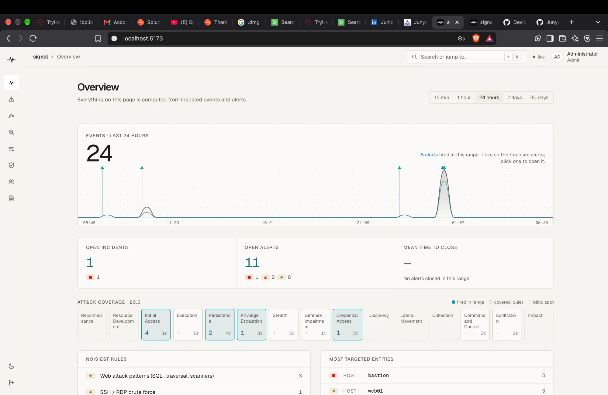
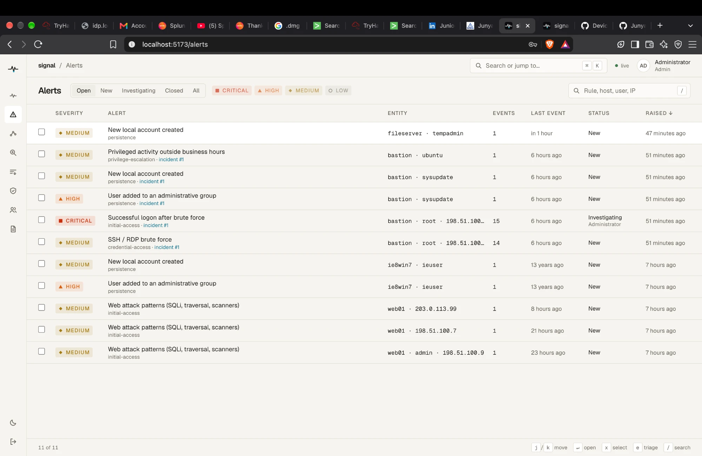
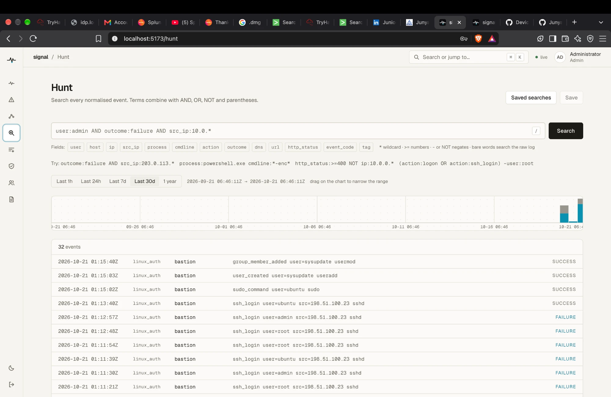
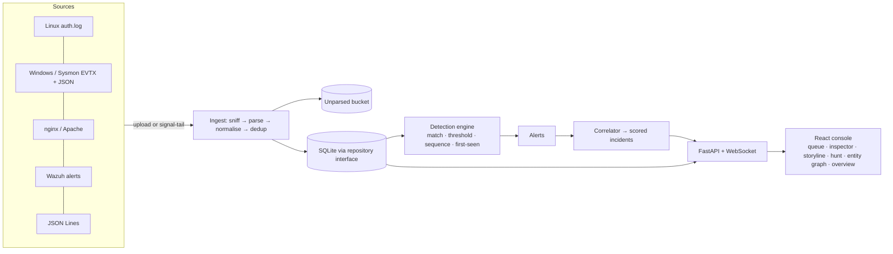

# signal

**A self-hosted mini SIEM and detection console.** Ingest security logs, normalise them,
run ATT&CK-mapped detections, correlate alerts into scored incidents, and triage them
from a fast, keyboard-driven console: *alert → triage → investigate → verdict → report.*



<table>
<tr>
<td width="50%"></td>
<td width="50%"></td>
</tr>
<tr>
<td><sub>Virtualised alert queue: <code>j</code>/<code>k</code>, <code>e</code> to triage, bulk actions</sub></td>
<td><sub>Hunt: <code>user:admin AND outcome:failure AND src_ip:10.0.*</code> with a brush-select time scrubber</sub></td>
</tr>
</table>

## What it does

- **Ingests** Linux auth logs, Windows Security and Sysmon (`.evtx`, `evtx_dump` JSON, PowerShell `Get-WinEvent` JSON, Wazuh-wrapped events), nginx/Apache access logs, Wazuh `alerts.json`, and any JSON Lines via a field mapping, by upload, API or a live `signal-tail` shipper. Every raw record is kept; unparsable lines go to a visible bucket with the reason.
- **Detects** with 16 Sigma-inspired YAML rules (match, threshold, sequence, first-seen), each with a positive and a negative test, mapped to **MITRE ATT&CK v20.0**, with a retro-hunt over history.
- **Correlates** alerts that share a host, user or IP into one incident, scored by severity, tactic breadth and kill-chain order, shown as an **ATT&CK storyline**.
- **Investigates** with entity pages and a relationship graph, a hunt query language, a time scrubber and saved searches.
- **Triages** with a status/verdict workflow, notes and a full audit trail, then **exports** an incident report as Markdown or a print-ready PDF page.
- **Protects itself**: Argon2id, CSRF, server-side roles, CSP, sanitised log rendering, injection-safe search. See [SECURITY.md](SECURITY.md).

## Run it

**Docker (one command)** *(written, not yet tested by the author, see below)*

```bash
cp .env.example .env        # set SIGNAL_ADMIN_EMAIL and a 12+ character SIGNAL_ADMIN_PASSWORD
docker compose up --build   # http://localhost:8080
```

**Without Docker** (needs [uv](https://docs.astral.sh/uv/) and Node 22)

```bash
cp .env.example .env
make install
make dev                    # API :8000, UI http://localhost:5173
make seed                   # in a second terminal: load the sample attacks
```

Sign in with the admin from `.env`. Press `⌘K` for the command palette and `?` for shortcuts.

## Sample attacks

`make seed` loads one business day for a fake company with **three planted attacks** and
**four false-positive baits**. Each should become exactly what [docs/scenarios.md](docs/scenarios.md)
says, and `backend/tests/test_seed_scenarios.py` checks that on every test run.

| Scenario | Becomes |
|---|---|
| SSH brute force → success → sudo → new admin user (Linux) | 1 critical incident, 6 alerts |
| Phishing → Word spawns encoded PowerShell → certutil → new admin → log cleared (Windows) | 1 critical incident, 7 alerts |
| DNS exfiltration from a workstation (Sysmon 22) | 1 incident, 2 alerts |
| Backup job at 2 am, helpdesk creating a user, admin checking a CRL, a vuln scan | stand-alone alerts to triage and close |

## Detection catalogue

| Rule | Logic | Severity | Tactic | Techniques |
|---|---|---|---|---|
| SSH / RDP brute force | threshold | medium | Credential Access | `T1110.001` |
| Password spraying | threshold | high | Credential Access | `T1110.003` |
| Successful logon after brute force | sequence | critical | Initial Access | `T1110`, `T1078` |
| certutil used to download or decode a file | match | high | Command and Control | `T1105`, `T1140` |
| Windows Security log cleared | match | high | Defense Impairment | `T1685.005` |
| Signed binary proxy execution with a remote payload | match | high | Stealth | `T1218.005`, `T1218.010`, `T1218.011` |
| Encoded PowerShell command | match | high | Execution | `T1059.001`, `T1027.010` |
| Office application spawned a shell or script host | match | high | Execution | `T1204.002`, `T1059.001`, `T1059.003`, `T1059.005` |
| DNS tunnelling (long or high-entropy subdomains) | threshold | high | Exfiltration | `T1048.003`, `T1071.004` |
| High DNS query volume to one domain | threshold | medium | Exfiltration | `T1048.003`, `T1071.004` |
| First-seen process on host | first-seen | low | — | — |
| User added to an administrative group | match | high | Persistence | `T1098.007` |
| New local account created | match | medium | Persistence | `T1136.001` |
| Privileged activity outside business hours | match | medium | Privilege Escalation | `T1078` |
| Wazuh high-severity alert | match | critical | — | — |
| Web attack patterns (SQLi, traversal, scanners) | match | medium | Initial Access | `T1190` |

Rules live in [`backend/rules/`](backend/rules). Techniques are checked against a pinned copy of the official ATT&CK data in CI; a rule that uses an unknown, deprecated or revoked ID fails the build.

## Architecture



- **Backend:** Python 3.12, FastAPI, SQLModel/SQLAlchemy + Alembic, Pydantic v2, `python-evtx`, `defusedxml`, Argon2. Storage sits behind repository interfaces so Postgres can replace SQLite.
- **Front end:** React 18, TypeScript (strict), Vite, Tailwind v4 design tokens, TanStack Query/Table/Virtual, React Flow, `cmdk`. The trace and scrubber are hand-written canvas/SVG.
- **One process, no broker:** an in-process worker handles uploads; live updates use one WebSocket.

## Quality

- **Backend:** 247 tests (parsers on real EVTX samples, every rule positive and negative, correlation, triage, search injection, auth and permissions, the seeded scenarios). `ruff` and `mypy --strict` clean.
- **Front end:** 32 tests (query bar, triage flow, scrubber, graph layout, XSS rendering) plus **axe-core** accessibility checks on seven views. Strict TypeScript and type-aware ESLint.
- **End to end:** one Playwright test: sign in → upload the sample → see the incident → triage → export the report (`make e2e`).
- **Performance:** on 100,000 events, hunts take 10–220 ms (`backend/scripts/perf_check.py`).
- **Accessibility:** WCAG AA contrast computed for every colour pair in both themes, visible focus rings, `prefers-reduced-motion` honoured, severity never shown by colour alone.

## What building this taught me

*(Draft written from the actual work. Edit it into your own voice.)*

- **Threat models change what "correct" means.** Logs are attacker-controlled, so the raw-log renderer only emits text nodes, the report escapes everything, and search is an AST, not string-building.
- **Detection quality is mostly about what you exclude.** Windows logs 4672 for every admin logon; without excluding machine accounts and pairing it with business hours, the rule would never stop firing. Correlation had the same lesson: a scanner must not merge into a host incident.
- **Standards move.** ATT&CK v20 split Defense Evasion and revoked T1070.001; a test that validates IDs against the official data caught it.
- **Sequence rules need event-time thinking.** Windows are measured in event time, so uploading last week's logs after this week's gives the same alerts, and re-running a retro-hunt is idempotent.
- **Real data finds bugs fixtures don't.** Real EVTX samples exposed a Windows group literally named "None" being dropped, and group-membership events that log only a SID.

## Known limits

- The Docker setup is written but has not been run end to end by the author.
- The printable report is print-to-PDF from the browser (no server-side PDF renderer).
- No Lighthouse score has been recorded; accessibility was verified with axe-core and computed contrast.
- v1 has no MFA/SSO and is single-tenant; see [SECURITY.md](SECURITY.md).

## Roadmap

Sigma rule import · Postgres · threat-intel enrichment (VirusTotal, AbuseIPDB) · Wazuh live integration (pull and active response) · server-side PDF · SSO.

## Layout

```
backend/    FastAPI API, detection engine, correlator, search, reports, rules/, tests
frontend/   React console and component tests
tools/      signal_tail.py (live shipper) and seed/ (synthetic data)
e2e/        Playwright end-to-end test
docs/       scenarios.md and screenshots
```

ATT&CK® is a registered trademark of The MITRE Corporation; ATT&CK data is used under the [ATT&CK Terms of Use](https://attack.mitre.org/resources/legal-and-branding/terms-of-use/). The sample EVTX files in `backend/tests/fixtures/ingest/evtx` come from [omerbenamram/evtx](https://github.com/omerbenamram/evtx) (Apache-2.0).
